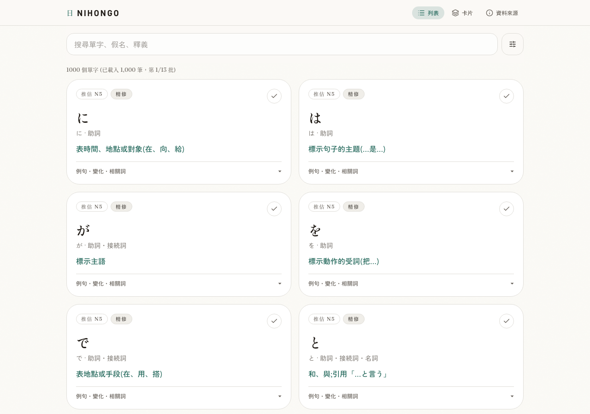

# Nihongo Vocab Trainer

A Japanese vocabulary study app for Traditional Chinese learners. Browse and search a 13,000-entry corpus, study selected collections with flashcards, and keep learning progress in your browser.

The interface is in Traditional Chinese. The corpus is still being reviewed; this is a study aid, not a verified dictionary or an official JLPT word list.



[Mobile flashcard preview](docs/images/study-mobile.png)

## Run locally

Use Node.js 22 and npm. No account, database, or model API key is required for the default local mode.

```sh
git clone https://github.com/Chuliying/nihongo-vocab-trainer.git
cd nihongo-vocab-trainer
nvm use # optional; select Node 22 with your preferred version manager
npm ci
npm run dev
```

Open http://localhost:3000. Start with the common-verb collection, switch between list and card views, or search by word, kana, and meaning. Learned words and session state are saved in this browser's localStorage. They do not sync across devices; clearing site data removes them.

The default `VOCAB_DATA_SOURCE=json` reads the tracked chunk files on the server. If you already have a local environment file that selects a database, run `VOCAB_DATA_SOURCE=json npm run dev` to use the local corpus explicitly. Do not copy another installation's credentials.

## Features

- Progressive browsing and server-side search across the full corpus.
- Collections for common verbs, adjectives, adverbs, conjunctions, and 500 selected nouns.
- Sequential and random flashcard sessions, mobile swipe, and related-word navigation.
- Deterministic verb conjugations for supported, reviewed entries.
- Source links, contributor credits, and license information for attributed Tatoeba examples.

## Data quality and licenses

There are 13,000 entries in 52 chunks and 13 learning layers. Counts describe coverage, not correctness. Some meanings and usage labels still need semantic review. A content filter hides known low-value examples, but passing that filter does not certify a sentence as correct. Labels such as “curated” describe the curation workflow, not teacher certification.

N1–N5 labels are rank-based estimates. The ordering uses wordfreq with a few essential-verb adjustments; it is not an official JLPT or BCCWJ ranking. Historical audit flags include missing provenance as well as content issues, so a flagged-entry count must not be described as a count of wrong words.

See [data licenses and attribution](DATA_LICENSES.md), the app's `/sources` page, and the [sentence credit manifest](public/data/attribution/tatoeba.json). Original dictionary and wordfreq download versions were not recorded. The runtime corpus, legacy seed files, and historical curation artifacts have different roles and must not be interchanged.

**The application code has no general reuse license at present.** Public visibility permits inspection; it is not an MIT or Apache license grant. Third-party data retains the licenses described in `DATA_LICENSES.md`.

## Architecture

```text
List / flashcards → focused API routes → vocabulary repository
                                         ├─ JSON chunks (default)
                                         └─ PostgreSQL (optional)
Learning progress → browser localStorage
```

Next.js and React render the interface. A repository boundary keeps JSON and PostgreSQL access behind the same API. Search, direct lookup, and collection endpoints return focused payloads; the full corpus and attribution manifest stay out of client bundles. Source credits are attached at the server boundary in both data modes.

For PostgreSQL, see [the database notes](docs/data/vocab-db-migration-audit.md). The app uses `VOCAB_DATA_SOURCE=db` and a server-only `DATABASE_URL`. Import commands write to the configured database: they are maintenance operations, not part of local setup. This release preparation does not import or change production data.

## Development checks

```sh
npm run typecheck
npm run lint
npm run test:unit
npm run audit:copy
npm run build
npx playwright install chromium
npm run test:e2e
```

Browser tests use local JSON data and a local server. They include real-corpus search and navigation checks as well as mocked error/race scenarios. Test success covers those behaviors; it does not establish semantic correctness of all vocabulary.

`npm run validate:chunks` is the stricter content-quality audit. It currently reports unresolved corpus issues and is not a passing release gate. Preserve that distinction when reporting results.

## Corpus maintenance

Edit source: `public/data/chunks/vocab_chunk_*.json`. Never replace these with the older `public/data/vocab_13000.json` seed. The hosted database is synchronized separately by an explicitly authorized import.

Read `VOCAB_CLEANUP_STATE.json`, `CLAUDE.md`, and `.claude/skills/vocab-cleanup/SKILL.md` before curation. The state file records historical checkpoints and constraints; remeasure before presenting its counts as current. Generated candidates require review. Do not infer verb conjugations with an LLM or apply related-word links from vector similarity alone.

Bug reports should include the word or entry ID, the observed behavior, and a reliable reference when reporting a language issue. Do not include account credentials or personal study data.
