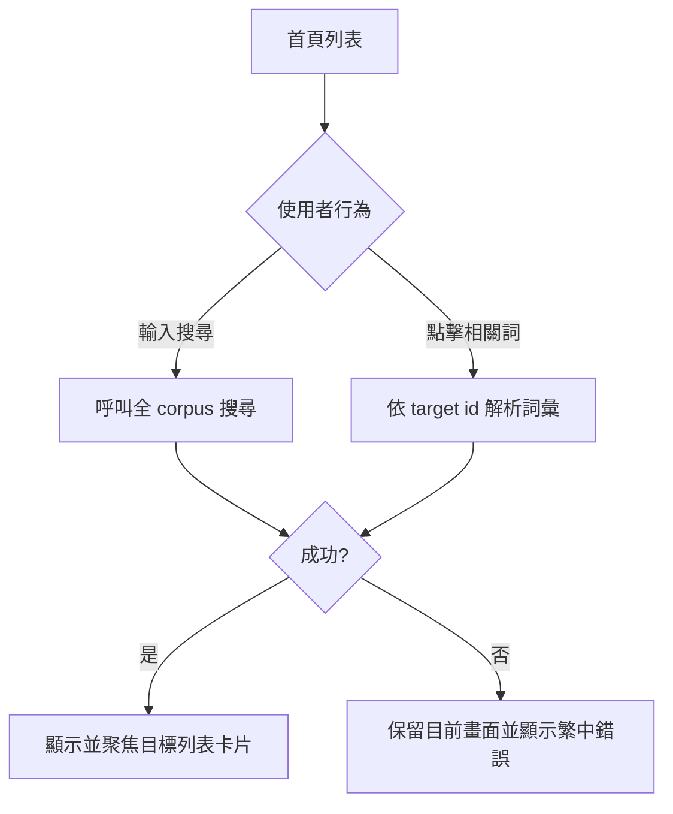

# 核心學習閉環校正 PRD

**Story ID**: S-HOME-01  
**版本**: v1.0.0  
**狀態**: 已完成
**Sprint**: Sprint 1  
**Tickets**: 不適用，因為本工作直接由 repository task 啟動

## 版本歷史

| 版本 | 修改時間 | 修改內容（摘要） | 影響範圍 | 對應 Spec 版本 | 作者 |
|------|---------|----------------|---------|--------------|------|
| v1.0.0 | 2026-08-10 10:00 | 初版 | 首頁搜尋、相關詞導航、產品文案 | v1.0.0 | Codex |

## 📌 Follow-ups

無待確認事項。使用者已明確選擇方案 A，並要求完成實作與全域字詞校正。13,000 筆 corpus 內容重編不在本 Story 範圍內。

## 0. 防禦性思考（Failure Constraints）

| 風險 | 說明 | 緩解策略 |
|------|------|---------|
| 🔴 資料來源不一致 | JSON 與 Postgres 搜尋結果或單字解析行為不同 | 所有新 repository method 同時提供 JSON/DB 實作，並以共用型別、排序與 limit 契約驗證 |
| 🟡 UX 競態 | 快速輸入或連點相關詞可能讓較舊請求覆蓋新狀態 | debounce、AbortSignal 或 ignore token；只接受最後一次有效回應 |
| 🟠 範圍蔓延 | 「修正所有字詞」被誤解為人工重編 13,000 筆詞庫 | 僅修正 learner-facing copy、現行文件與舊系統術語；corpus 重編另立資料品質專案 |

## 0.5 最佳實踐搜尋結果

| 來源 | 關鍵發現 |
|------|---------|
| [Next.js Route Handlers](https://nextjs.org/docs/14/app/building-your-application/routing/route-handlers) | Route Handler 可直接從 `Request` URL 解析查詢參數，適合建立 focused search endpoint |
| [React Effect data fetching](https://react.dev/reference/react/useEffect) | Effect cleanup 應忽略較舊回應，避免網路回應順序造成 race condition |
| [PostgreSQL Pattern Matching](https://www.postgresql.org/docs/current/functions-matching.html) | 使用簡單、參數化的 pattern matching；避免讓使用者輸入變成任意 regex |
| [Next.js search and pagination](https://nextjs.org/learn/dashboard-app/adding-search-and-pagination) | 搜尋狀態可透過 URLSearchParams 表達並與 App Router 導航整合 |

### 採用策略

- ✅ 建立 bounded、read-only、focused API，不把 13,000 筆資料送至瀏覽器後再搜尋。
- ✅ Client request 使用 debounce 與 stale-response cleanup。
- ✅ Related-word 透過 id 解析後回到 canonical list workspace。
- ❌ 不加入新的全文搜尋服務或索引系統；13,000 筆規模尚不需要額外基礎設施。

## 1. 概述

### 商業目標

讓「13,000 詞可學習」從資料宣稱變成可完成的使用者行為：任一詞能被找到，任一可解析相關詞能被抵達，且產品文字不再互相矛盾。

### Personas + 痛點

| Persona | 描述 | 目前痛點 |
|---------|------|---------|
| 繁中日語學習者 | 使用手機查找並翻卡複習常用日語詞彙 | 搜尋只涵蓋已載入批次；相關詞點擊在部分模式沒有結果；Sources 仍宣稱舊 corpus 規模 |

### 效能期望

- 搜尋最多回傳 100 筆（server hard cap 200）。
- warm JSON search 在本機驗證環境目標 < 500ms。
- 使用者持續輸入時，不顯示舊 query 的結果。

### 成功指標

| 指標 | 目標值 | 衡量方式 |
|------|--------|---------|
| 全 corpus 搜尋覆蓋 | 可找到位於尚未載入 tranche 的已知測試詞 | repository + browser smoke test |
| 相關詞抵達率 | 所有具有有效 `target_id` 的測試情境皆抵達對應卡片 | unit + E2E |
| 現行產品術語一致性 | active UI/docs 無 10,000、10 tranche、LibraryPage、PracticePage 舊宣稱 | deterministic `rg` audit |

## 1.5 流程圖



## 2. 功能需求（FR）

### FR-001：全詞庫搜尋

**描述**：在 `collection=all` 時，搜尋必須查詢完整 13,000 詞，而非只查已載入 tranche。

**輸入**：query 字串與 bounded limit。  
**輸出**：依 frequency rank 排序的 `VocabEntry[]`。

**邊界條件**：空白 query 回傳空陣列；limit 受 server hard cap；特殊字元視為文字，不作 regex。  
**Data 來源狀態**：✅ 已有 corpus，需新增 focused API 與 repository method。  
**權限/可見性**：所有使用者，read-only。

### FR-002：可靠的相關詞導航

**描述**：從列表或卡片模式、任一 collection 點擊有效相關詞，都能解析目標並回到 canonical list workspace 顯示該詞。

**輸入**：`target_id`。  
**輸出**：目標詞卡片可見並取得程式化 focus。

**邊界條件**：target 不存在或 API 失敗時不改變目前 scope。  
**Data 來源狀態**：✅ 已有 `target_id` 與 corpus，需新增 id lookup API。  
**權限/可見性**：所有使用者。

### FR-003：產品字詞一致性

**描述**：使用者可見英文片段改為自然繁中，所有現行文件與頁面使用正確 corpus 規模及目前元件／資料架構名稱。

**輸入**：active UI strings 與 current-state docs。  
**輸出**：校正後文案與 deterministic audit 結果。

**邊界條件**：品牌 `Nihongo`、資料來源專名與 corpus 內日文不翻譯。  
**Data 來源狀態**：✅ repository 內既有文字。  
**權限/可見性**：所有使用者及專案維護者。

## 3. 非功能需求（NFR）

| 類別 | 要求 |
|------|------|
| Performance | 搜尋回傳 hard cap 200；空 query 不掃描 corpus；Client debounce 並忽略 stale response |
| Security / Compliance | endpoint read-only；query/limit server-side 驗證；Postgres 使用參數化查詢，不接受 regex |
| Accessibility | 搜尋結果與相關詞錯誤可被文字讀取；目標卡片可程式化 focus；現有 icon button label 保留 |
| Compatibility | Next.js 15 App Router；mobile-first；JSON 與 Postgres repository 契約一致 |

## 4. 錯誤場景（ERR）

### ERR-001：搜尋失敗

**觸發條件**：搜尋 endpoint 非 2xx 或網路失敗。  
**預期行為**：顯示「搜尋失敗，請稍後再試。」且保留 query。  
**恢復策略**：修改 query 或重試。

### ERR-002：相關詞不存在

**觸發條件**：target id 合法但 corpus 無此詞。  
**預期行為**：顯示「找不到這個相關詞。」且不切換 scope。  
**恢復策略**：關閉提示後繼續目前學習。

### ERR-003：無效 request

**觸發條件**：id 非正整數或 limit 非數字。  
**預期行為**：API 回傳 400 JSON error，不執行 repository scan。  
**恢復策略**：Client 不應產生此 request；測試確認契約。

### ERR-004：快速請求競態

**觸發條件**：舊 request 比新 request 晚回來。  
**預期行為**：舊結果不得覆蓋目前 query 或 navigation。  
**恢復策略**：不需使用者操作。

## 5. 驗收標準（AC）

### AC-001：搜尋尚未載入的詞

```gherkin
Given 使用者開啟首頁且瀏覽器只載入第一個 tranche
When 使用者輸入只存在於後段 tranche 的已知詞彙
Then 列表顯示該詞彙而不要求使用者先捲動載入全部 tranche
```

### AC-002：搜尋邊界與錯誤

```gherkin
Given 搜尋 endpoint 已啟用且使用者位於全部詞庫
When query 為空白、無結果、超過 limit 或 request 失敗
Then 系統分別呈現空搜尋、無結果、bounded 結果或繁中錯誤狀態
```

### AC-003：跨模式相關詞導航

```gherkin
Given 目前詞卡具有可解析的 related target_id
When 使用者從列表或卡片模式點擊該相關詞
Then 系統切換到全部詞庫列表並顯示及聚焦正確目標詞卡
```

### AC-004：無效相關詞保持狀態

```gherkin
Given 使用者位於任一 collection 且相關詞 target 不存在
When 使用者點擊該相關詞
Then 系統保留目前 view 與 collection 並顯示「找不到這個相關詞。」
```

### AC-005：文案與文件一致

```gherkin
Given repository 使用 13,000 詞、13 tranche、52 chunks 的現行架構
When 執行 active UI 與 current-state docs 的文字 audit
Then 不存在舊 corpus 規模、舊元件名稱或未授權的 learner-facing English session 文案
```

## 6. UI/UX 概念

不新增版面；沿用搜尋框、列表、卡片與既有錯誤文字區域。

| State | 設計描述 | 文案 |
|-------|---------|------|
| Empty | 保留目前置中空狀態 | 找不到符合條件的單字。 |
| Loading | 使用既有 skeleton | 不適用，因為 skeleton 已表達載入中 |
| Error | sticky filter 區域下方顯示 destructive text | 搜尋失敗，請稍後再試。／找不到這個相關詞。 |
| Success | 顯示搜尋結果並 focus 目標卡片 | 不適用，因為結果本身即成功回饋 |
| Disabled | 無有效 `target_id` 的相關詞維持 disabled | 不適用 |

### Microcopy

| 元件 | 文案 |
|------|------|
| 卡片提示 | 點擊翻面・左右滑動 |
| 隨機模式 | 隨機練習 |
| Session 結束 | 本次練習完成 |
| 導覽 | 資料來源 |
| Search error | 搜尋失敗，請稍後再試。 |
| Related error | 找不到這個相關詞。 |

### 響應式行為

Mobile、Tablet、Desktop 皆沿用現有列表欄數與卡片寬度；本 Story 不改布局。

## 7. Dependencies & Constraints

- **上游依賴**：既有 `VocabEntry`、repository selector、UnifiedPage。
- **下游影響**：未來 SRS 可重用 direct lookup 與 corpus search。
- **Breaking Change**：❌ 否；只新增 API，既有 endpoint 保持相容。
- **Assumptions**：JSON 是預設 runtime source；DB 實作至少通過型別與契約 review。

## 8. 範圍外

- ❌ corpus 13,000 筆內容重編。
- ❌ SRS、答題評分、每日複習。
- ❌ 帳號、雲端同步、視覺 redesign。

## 9. 相關文件

| 文件 | 連結 |
|------|------|
| 設計 | `docs/plans/2026-08-10-core-loop-integrity-design.md` |
| 技術規格 | `docs/spec/pages/home/stories/s01-core-loop-integrity.md` |
| QA 方案 | `docs/qa/pages/home/stories/s01-core-loop-integrity.md` |

## Gate 1 自檢

- [x] Sprint、三項風險、官方 research、FR/Data source、4 ERR、5 AC 完整。
- [x] 範圍外、NFR、UI states、microcopy、dependency 與 page flow 完整。
- [x] 無阻擋型 FU；PM/RD/User/QA/UI 五視角可驗收。
